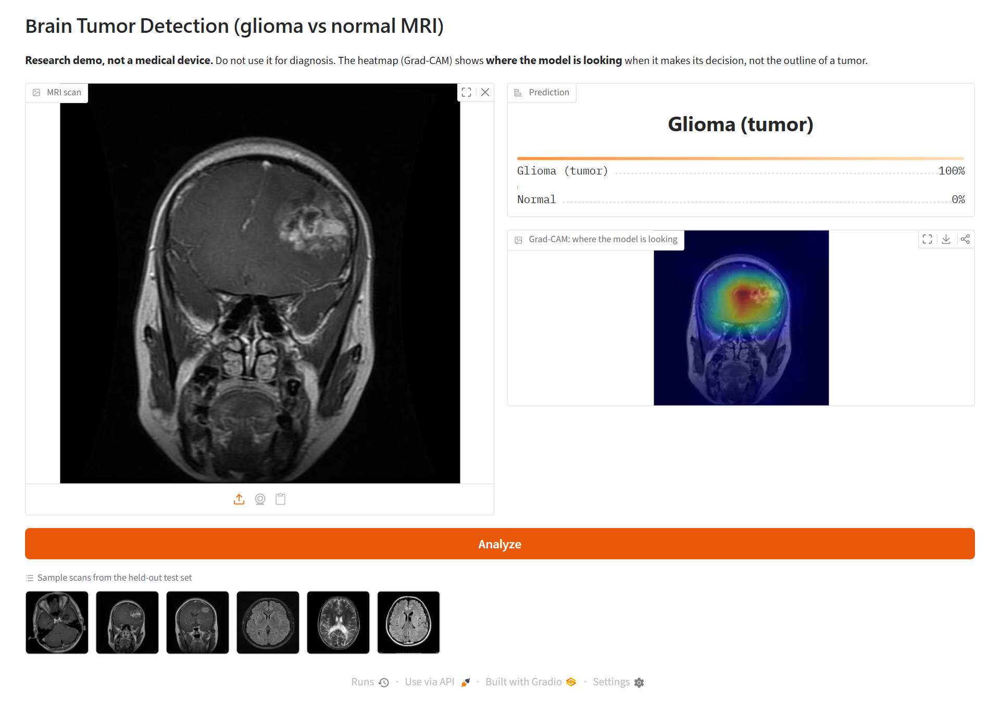
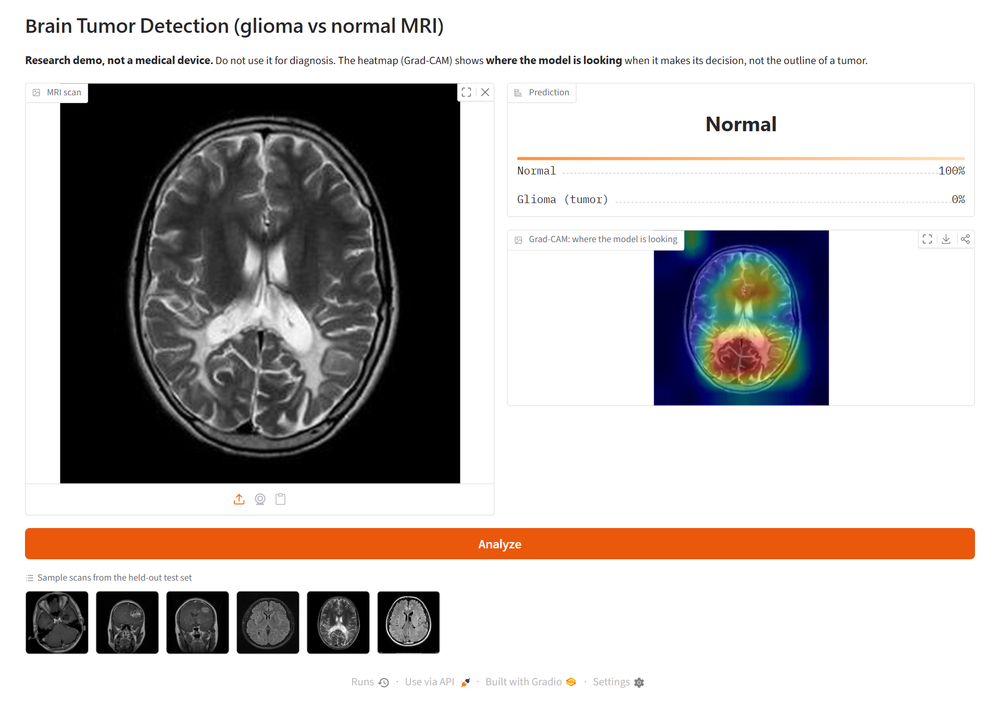
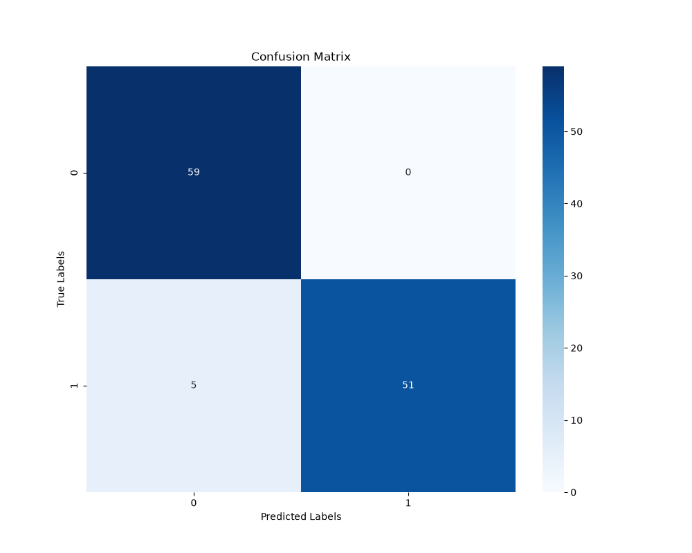
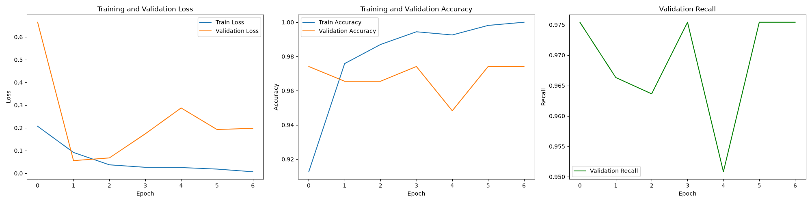
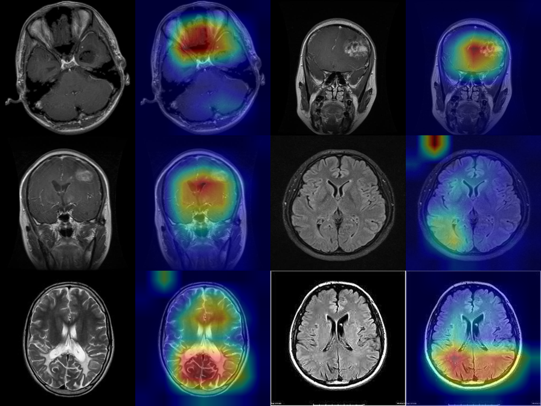

# Brain-Tumor-Detection-DL
This project is a deep learning-based binary image classification model that detects the presence of brain tumors in MRI scans. Leveraging convolutional neural networks (CNNs) and data augmentation techniques, the model distinguishes between tumor (e.g., glioma) and normal brain images. The dataset is manually labeled and preprocessed for optimal performance. This tool is designed to support medical diagnostics by offering fast, automated, and accurate tumor detection.

> **Research demo, not a medical device.** This model is a learning project and must not be used for diagnosis.

**Demo app:** upload an MRI or click a sample scan to get a prediction, a confidence score and a Grad-CAM heatmap. It runs locally in a few minutes, see [Try the demo](#try-the-demo).




## How it works
- **Model:** ResNet50 pretrained on ImageNet. Only `layer4` and a new `Dropout + Linear` head are trained (transfer learning).
- **Augmentation:** random horizontal flip, rotation (±10°), brightness/contrast jitter.
- **Training:** Adam (lr 1e-3, weight decay 1e-4), ReduceLROnPlateau, batch size 32, up to 15 epochs with early stopping (stops after 5 epochs without a lower validation loss).
- **Evaluation:** stratified **70 / 15 / 15** train / validation / test split (538 / 116 / 115 images). The epoch with the lowest validation loss becomes the final model. The test set is only used at the end.
- **Duplicate-aware split:** the dataset contains the same scan saved under different filenames (769 images = 681 unique scans). Near-identical images are grouped with a perceptual hash plus a pixel-difference check, and each group is kept inside one split, so no scan appears in both training and test.
- **Confidence intervals:** test metrics are reported with bootstrap 95% CIs (1,000 resamples). With 115 test images, a single accuracy number can easily move a few percent, and the interval shows how far.
- **Explainability:** Grad-CAM on the last convolutional block (`layer4`), in `gradcam.py`.

## Results (held-out test set)

| Metric | Score | 95% CI |
|---|---|---|
| Accuracy | 95.7% | 91.3 – 99.1% |
| Recall (macro) | 95.5% | 91.3 – 99.0% |
| Precision (macro) | 96.1% | 92.4 – 99.1% |
| F1 (macro) | 95.6% | 91.3 – 99.1% |
| ROC-AUC | 0.989 | 0.971 – 1.000 |

Per class: **glioma recall 91.1%** (5 of 56 tumors missed), normal recall 100% (no false alarms). For a screening tool the missed tumors are the more serious error, so improving tumor recall is the main area for future work.




> An earlier version of this project reported 98% accuracy and recall. That number was measured on the validation set that was also used to pick the best model, so it was optimistic. The table above comes from a separate test set and supersedes it. The full write-up, [`Brain Tumor Detection Using Deep Learning.pdf`](Brain%20Tumor%20Detection%20Using%20Deep%20Learning.pdf), has been revised with these results.

**How the evaluation was fixed (for transparency):**
1. Added a held-out test set. The first run, which kept the original "best validation accuracy" rule, scored 94.0% on test. That rule kept epoch 1 because later epochs only tied its accuracy, even though their validation loss was less than half as high.
2. Switched model selection to the lowest validation loss. The reason for this change was visible in the validation numbers alone.
3. Found exact and near-duplicate scans crossing the train/test boundary, and made the split duplicate-aware. The table above is from this final run. No further changes were made after seeing it.

## About the Grad-CAM heatmap
Grad-CAM highlights the regions that most influenced the model's decision: **where the model is looking**. It is not a tumor outline or a segmentation. Getting real tumor boundaries would need a segmentation model trained on pixel-level masks.


*Test-set scans (top row and middle-left: glioma; others: normal), each next to its heatmap.*

What the heatmaps show, honestly: on most glioma scans the model focuses on or near the tumor. On some scans, though, it looks elsewhere. On two of the normal scans there is a hot spot in the corner outside the skull, which suggests the model also picks up on image artifacts and not only on anatomy. This is exactly what Grad-CAM is useful for: checking *why* a model is right, not just *whether* it is.

## Dataset
[PMRAM: Bangladeshi Brain Cancer - MRI Dataset](https://data.mendeley.com/datasets/m7w55sw88b/1) (Mendeley Data, doi:10.17632/m7w55sw88b.1), licensed CC BY 4.0. This project uses only the **glioma** and **normal (no tumor)** classes: 769 images, listed with labels in `brain_tumor_labels.csv` (1 = glioma, 0 = normal).

1. Download the dataset from Mendeley.
2. Copy the **raw** (non-augmented) glioma and normal images into `./data/` (subfolders are fine; images are found by filename).
   Don't use the dataset's pre-augmented images. Augmented copies of the same scan would end up in both train and test and inflate the score.

## Try the demo
No dataset or training needed: the trained model is attached to the [v1.0 release](https://github.com/musawaghu/Brain-Tumor-Detection-DL/releases/tag/v1.0).
```bash
git clone https://github.com/musawaghu/Brain-Tumor-Detection-DL.git
cd Brain-Tumor-Detection-DL
python -m venv .venv
.venv\Scripts\activate          # Windows  (Linux/macOS: source .venv/bin/activate)
pip install -r requirements.txt

# Download the trained model (94 MB) into the project folder
curl -L -o final_brain_mri_model.pth https://github.com/musawaghu/Brain-Tumor-Detection-DL/releases/download/v1.0/final_brain_mri_model.pth

python app.py    # open http://127.0.0.1:7860 and click a sample scan
```

## Training it yourself
Download the dataset first (see [Dataset](#dataset)), then:
```bash
python main.py   # trains, prints test metrics + 95% CIs, saves final_brain_mri_model.pth and plots
pytest           # runs the tests (the app test runs once final_brain_mri_model.pth exists)
```
Training takes a few minutes on a mid-range GPU (RTX 2060 Super); early stopping usually ends it after about 7 epochs. For a GPU build of PyTorch, see pytorch.org/get-started.

### Sample scans for the demo
The demo's sample images must come from the **test** split, so visitors only see scans the model never trained on. After training:
```bash
python -c "import pandas as pd, shutil, glob; t = pd.read_csv('test_split.csv'); [shutil.copy(glob.glob(f'data/**/{f}', recursive=True)[0], 'samples/') for f in pd.concat([t[t.label == 1].head(3), t[t.label == 0].head(3)]).filename]"
```
(Create the `samples/` folder first.)

## Limitations
- **Single dataset, single source.** Performance on scans from other hospitals or scanners is unknown.
- **No patient IDs.** Exact and near-duplicate images are kept in one split, but different slices from the same patient (for example consecutive slices through the same tumor) can still land in both train and test. That may make the test score somewhat optimistic.
- **Possible shortcut: scan type.** Most glioma images are T1 post-contrast scans, while most normal images are T2/FLAIR. The model may partly be recognising the scan type instead of the tumor. A fair test would need tumor and normal scans of the same sequence.
- **Binary only.** Glioma vs normal; meningioma, pituitary tumors and tumor grade aren't handled.
- **Grad-CAM is not segmentation.** See above.

## Project structure
```
main.py                   training + evaluation (split, bootstrap CIs, plots)
gradcam.py                Grad-CAM heatmap + overlay
app.py                    Gradio web demo
tests/test_project.py     pytest tests
gradcam_examples.png      Grad-CAM examples from the test set
samples/                  demo sample scans (from the test split)
brain_tumor_labels.csv    filename -> label (1 = glioma, 0 = normal)
```
